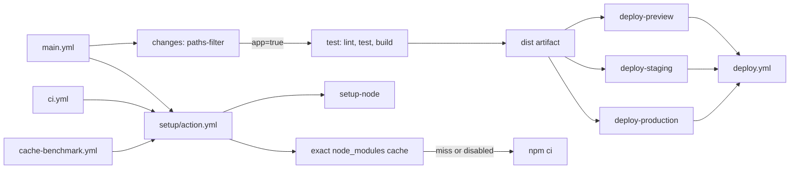

# 7주차 GitHub Actions 최적화 실습 보고서

측정일: 2026-11-11 (UTC 기준)  
저장소: [jaimejang0122/awesome-calculator](https://github.com/jaimejang0122/awesome-calculator)

## 1. 개요

`main.yml`은 경로 변경을 판별하고 앱 변경일 때만 테스트·빌드한 뒤, reusable workflow인 `deploy.yml`을 preview, staging 또는 production 환경으로 호출합니다. CI와 Main Pipeline은 공통으로 `setup/action.yml`을 사용합니다.



### 측정 방법

- 다섯 benchmark run 모두 `main`에서 수동 실행하고, 매 run의 완료를 확인한 다음에만 다음 run을 시작했습니다.
- job 시간과 `Setup Node project` composite step 시간은 각 `gh run view <id> --json jobs`의 `startedAt`·`completedAt` 차이로 계산했습니다. GitHub가 반환하는 이 값은 초 단위입니다.
- composite action 내부의 `npm ci`, cache restore, setup-node 소요는 `gh run view <id> --log`의 `end-action ... duration_ms` 원본을 사용했습니다. JSON jobs에는 composite 내부 step이 별도 항목으로 노출되지 않아 이 하위 단계만 run 로그를 출처로 삼았습니다.
- 개선률은 `(전 - 후) / 전 * 100`으로 계산했습니다. 표의 평균은 실제 run 값의 산술 평균이며, 목표치에 미달하더라도 관측값을 그대로 적었습니다.

## 2. 과제 1: Matrix 결과

가장 최근 CI 실행은 [main push run 42961868271](https://github.com/jaimejang0122/awesome-calculator/actions/runs/42961868271)이며 lint와 9개 matrix job이 모두 성공했습니다. 아래 job 시간은 `startedAt`부터 `completedAt`까지입니다.

| OS | Node | 시작 (UTC) | 완료 (UTC) | 시간 |
| --- | ---: | --- | --- | ---: |
| ubuntu-latest | 16 | 04:50:55 | 04:51:07 | 12초 |
| ubuntu-latest | 18 | 04:50:55 | 04:51:05 | 10초 |
| ubuntu-latest | 20 | 04:50:55 | 04:51:05 | 10초 |
| macos-latest | 16 | 04:50:55 | 04:51:08 | 13초 |
| macos-latest | 18 | 04:50:56 | 04:51:13 | 17초 |
| macos-latest | 20 | 04:50:55 | 04:51:11 | 16초 |
| windows-latest | 16 | 04:50:55 | 04:51:20 | 25초 |
| windows-latest | 18 | 04:50:55 | 04:51:21 | 26초 |
| windows-latest | 20 | 04:50:55 | 04:51:20 | 25초 |

| OS | 평균 | 최소 | 최대 |
| --- | ---: | ---: | ---: |
| ubuntu-latest | 10.7초 | 10초 | 12초 |
| macos-latest | 15.3초 | 13초 | 17초 |
| windows-latest | 25.3초 | 25초 | 26초 |

## 3. 과제 2: 중복 제거

비교 범위는 `.github/workflows/ci.yml`입니다. 변경 전 정의는 커밋 `80a878f`에서 확인했습니다.

| 항목 | 변경 전 | 변경 후 |
| --- | ---: | ---: |
| ci.yml의 직접 `setup-node` 호출 | 2회 | 0회 |
| ci.yml의 직접 `npm ci` 호출 | 2회 | 0회 |
| ci.yml의 composite setup 호출 | 0회 | 2회 |
| 공통 action 안의 setup-node 정의 | 0개 | 1개 |
| 공통 action 안의 조건부 npm ci 정의 | 0개 | 1개 |

Lint와 matrix test가 버전 설정을 각각 복제하지 않고 같은 action을 사용합니다. cache miss 또는 cache 비활성화 때만 공통 action 안에서 `npm ci`를 실행합니다.

## 4. 과제 3: 캐싱 측정

각 값은 세 OS job의 `gh run view --json jobs` 원본에서 계산했습니다. `job`은 전체 runner job 시간, `setup`은 `Setup Node project` composite step 시간입니다. 각 값 열의 숫자는 해당 모드의 순차 실행별 초입니다.

| OS | cache=false job (평균) | cache=true job (평균) | job 개선 | cache=false setup (평균) | cache=true setup (평균) | setup 개선 |
| --- | ---: | ---: | ---: | ---: | ---: | ---: |
| ubuntu-latest | 13, 12 (12.5초) | 11, 9, 10 (10.0초) | 20.00% | 7, 7 (7.0초) | 5, 5, 5 (5.0초) | 28.57% |
| macos-latest | 23, 21 (22.0초) | 21, 21, 11 (17.7초) | 19.70% | 14, 11 (12.5초) | 11, 10, 6 (9.0초) | 28.00% |
| windows-latest | 33, 23 (28.0초) | 23, 21, 24 (22.7초) | 19.05% | 19, 12 (15.5초) | 10, 9, 11 (10.0초) | 35.48% |

### 설치·캐시 단계

`npm ci`와 cache restore의 ms 값은 run 로그의 composite child action `duration_ms`입니다. false 조건에서는 cache action이 skipped이고 `npm ci`가 실행됐습니다. true 조건에서는 정확한 key가 hit되어 `npm ci`가 `skipped / 0ms`였습니다.

| OS | cache=false npm ci 실행값, 평균 | cache=true cache restore 값, 평균 | cache=true npm ci | 대체 시간 개선률 |
| --- | ---: | ---: | ---: | ---: |
| ubuntu-latest | 2,781; 3,440 ms (3,110.5 ms) | 994; 568; 998 ms (853.3 ms) | 0 ms, 모두 skipped | 72.57% |
| macos-latest | 4,262; 3,635 ms (3,948.5 ms) | 3,258; 2,830; 1,018 ms (2,368.7 ms) | 0 ms, 모두 skipped | 40.01% |
| windows-latest | 9,741; 6,050 ms (7,895.5 ms) | 2,239; 1,980; 1,894 ms (2,037.7 ms) | 0 ms, 모두 skipped | 74.19% |

대체 시간 개선률은 `(cache=false npm ci 평균 - cache=true cache restore 평균) / cache=false npm ci 평균 * 100`입니다. 이는 dependency 준비 단계끼리의 비교이며, 전체 job 또는 composite setup 시간 개선률과 구분합니다.

### 다섯 실행과 cache 이벤트

| 순서 | 설정 | Run |
| ---: | --- | --- |
| 1 | cache=false | [42962864881](https://github.com/jaimejang0122/awesome-calculator/actions/runs/42962864881) |
| 2 | cache=false | [42963003768](https://github.com/jaimejang0122/awesome-calculator/actions/runs/42963003768) |
| 3 | cache=true | [42963126789](https://github.com/jaimejang0122/awesome-calculator/actions/runs/42963126789) |
| 4 | cache=true | [42963229220](https://github.com/jaimejang0122/awesome-calculator/actions/runs/42963229220) |
| 5 | cache=true | [42963318070](https://github.com/jaimejang0122/awesome-calculator/actions/runs/42963318070) |

cache=false 두 run에서 cache step은 skipped였고 `npm ci`가 실행됐습니다. cache=true 첫 실행부터 이미 cache hit였으며, 다섯 true OS-job 모두 `Cache restored from key`를 남겼습니다. 첫 true run이 miss/save일 것이라는 예상과 달랐으므로 miss나 save를 관측했다고 기록하지 않습니다.

```text
42963126789 ubuntu:   Cache restored from key: Linux-node20-modules-ab453973cfedd96bc4f414ec2588531f6430b51d4d93f861cc5702dad5238e66
42963126789 macos:    Cache restored from key: macOS-node20-modules-ab453973cfedd96bc4f414ec2588531f6430b51d4d93f861cc5702dad5238e66
42963126789 windows:  Cache restored from key: Windows-node20-modules-36dc958db01b27c7d0a7412245910f9c64ed2648bfd9e7be20b9b78ec9e4476b
42963229220 ubuntu:   Cache restored from key: Linux-node20-modules-ab453973cfedd96bc4f414ec2588531f6430b51d4d93f861cc5702dad5238e66
42963229220 macos:    Cache restored from key: macOS-node20-modules-ab453973cfedd96bc4f414ec2588531f6430b51d4d93f861cc5702dad5238e66
42963229220 windows:  Cache restored from key: Windows-node20-modules-36dc958db01b27c7d0a7412245910f9c64ed2648bfd9e7be20b9b78ec9e4476b
42963318070 ubuntu:   Cache restored from key: Linux-node20-modules-ab453973cfedd96bc4f414ec2588531f6430b51d4d93f861cc5702dad5238e66
42963318070 macos:    Cache restored from key: macOS-node20-modules-ab453973cfedd96bc4f414ec2588531f6430b51d4d93f861cc5702dad5238e66
42963318070 windows:  Cache restored from key: Windows-node20-modules-36dc958db01b27c7d0a7412245910f9c64ed2648bfd9e7be20b9b78ec9e4476b
```

### 캐시 키 설계

- `runner.os`는 서로 다른 운영체제의 `node_modules`를 섞지 않도록 key를 분리합니다.
- `node-version`은 서로 다른 Node ABI/runtime 버전의 의존성 디렉터리를 분리합니다.
- `hashFiles('package-lock.json')`는 lockfile이 바뀌면 새 key를 만들어 잘못된 의존성 캐시를 재사용하지 않도록 합니다.
- `restore-keys`를 두지 않아 부분 key로 오래되거나 불완전한 `node_modules`가 복원되어 `npm ci`를 건너뛰는 상황을 방지합니다.

## 5. 과제 4: 조건부 배포 증거

| 이벤트/변경 | Run | 관측된 job 결과 |
| --- | --- | --- |
| PR 앱 변경 → preview | [42961646569](https://github.com/jaimejang0122/awesome-calculator/actions/runs/42961646569) | changes/test/preview 성공, staging/production skipped |
| develop push 앱 변경 → staging | [42960190908](https://github.com/jaimejang0122/awesome-calculator/actions/runs/42960190908) | changes/test/staging 성공, preview/production skipped |
| main push 앱 변경 → production | [42961868349](https://github.com/jaimejang0122/awesome-calculator/actions/runs/42961868349) | changes/test/production 성공. production 승인을 거쳐 완료 |
| 문서 전용 변경 → 배포 skipped | 보고서 PR의 Main Pipeline 실행 링크를 PR 생성 후 추가 | app=false일 때 test와 deploy jobs가 skipped인지 확인 예정 |

환경 보호 규칙 조회 결과:

- `production`: required reviewer `jaimejang0122`; custom branch policy 사용; 허용 브랜치 `main`.
- `staging`: custom branch policy 사용; 허용 브랜치 `develop`.

## 6. 결론

관측한 다섯 cache benchmark run은 모두 세 OS에서 성공했습니다. 이번 표본에서는 cache hit 시 `npm ci`가 0ms/skipped였고, dependency 준비 시간 대체 개선률은 Ubuntu 72.57%, macOS 40.01%, Windows 74.19%였습니다. 전체 job 평균 개선률은 Ubuntu 20.00%, macOS 19.70%, Windows 19.05%였습니다. cache=true 첫 실행부터 hit였으므로 이번 실험은 cold-cache miss/save 시간을 측정하지 못했습니다. 세 번의 hit 결과만으로 장기적인 성능이나 비용 효과를 일반화할 수 없으며, 더 많은 반복·cold-cache 조건에서 재측정할 필요가 있습니다.

## 부록 A. 계산에 사용한 benchmark job 및 setup 원본

아래 원본 시각은 `gh run view <id> --json jobs` 응답의 `startedAt`과 `completedAt`입니다. 지속 시간은 이 값의 차이(초)입니다. 각 run 링크는 위 다섯 실행 표를 참조합니다.

| Run | Cache | OS | Job 시작 → 완료 (UTC) | Job 초 | Setup 시작 → 완료 (UTC) | Setup 초 |
| --- | --- | --- | --- | ---: | --- | ---: |
| 42962864881 | false | macOS | 05:00:35 → 05:00:58 | 23 | 05:00:39 → 05:00:53 | 14 |
| 42962864881 | false | Ubuntu | 05:00:32 → 05:00:45 | 13 | 05:00:35 → 05:00:42 | 7 |
| 42962864881 | false | Windows | 05:00:32 → 05:01:05 | 33 | 05:00:39 → 05:00:58 | 19 |
| 42963003768 | false | Windows | 05:01:43 → 05:02:06 | 23 | 05:01:48 → 05:02:00 | 12 |
| 42963003768 | false | Ubuntu | 05:01:43 → 05:01:55 | 12 | 05:01:45 → 05:01:52 | 7 |
| 42963003768 | false | macOS | 05:01:43 → 05:02:04 | 21 | 05:01:46 → 05:01:57 | 11 |
| 42963126789 | true | Ubuntu | 05:02:50 → 05:03:01 | 11 | 05:02:52 → 05:02:57 | 5 |
| 42963126789 | true | macOS | 05:02:52 → 05:03:13 | 21 | 05:02:55 → 05:03:06 | 11 |
| 42963126789 | true | Windows | 05:02:50 → 05:03:13 | 23 | 05:02:56 → 05:03:06 | 10 |
| 42963229220 | true | macOS | 05:03:48 → 05:04:09 | 21 | 05:03:52 → 05:04:02 | 10 |
| 42963229220 | true | Windows | 05:03:44 → 05:04:05 | 21 | 05:03:50 → 05:03:59 | 9 |
| 42963229220 | true | Ubuntu | 05:03:44 → 05:03:53 | 9 | 05:03:45 → 05:03:50 | 5 |
| 42963318070 | true | Ubuntu | 05:04:33 → 05:04:43 | 10 | 05:04:35 → 05:04:40 | 5 |
| 42963318070 | true | macOS | 05:04:33 → 05:04:44 | 11 | 05:04:34 → 05:04:40 | 6 |
| 42963318070 | true | Windows | 05:04:33 → 05:04:57 | 24 | 05:04:40 → 05:04:51 | 11 |

### 부록 B. 내부 action duration 원본 (ms)

아래 `setup-node`, `cache`, `npm ci` 원본은 각 benchmark run의 `gh run view <id> --log`에 있는 composite child action `end-action ... duration_ms` 값입니다. cache=false의 cache action은 0ms/skipped였고, cache=true의 npm ci는 0ms/skipped였습니다.

| Run | Cache | OS | setup-node ms | cache ms | npm ci ms |
| --- | --- | --- | ---: | ---: | ---: |
| 42962864881 | false | Ubuntu | 3,831 | 0 | 2,781 |
| 42962864881 | false | macOS | 8,363 | 0 | 4,262 |
| 42962864881 | false | Windows | 8,744 | 0 | 9,741 |
| 42963003768 | false | Ubuntu | 3,687 | 0 | 3,440 |
| 42963003768 | false | macOS | 7,052 | 0 | 3,635 |
| 42963003768 | false | Windows | 5,782 | 0 | 6,050 |
| 42963126789 | true | Ubuntu | 3,752 | 994 | 0 (skipped) |
| 42963126789 | true | macOS | 7,390 | 3,258 | 0 (skipped) |
| 42963126789 | true | Windows | 7,350 | 2,239 | 0 (skipped) |
| 42963229220 | true | Ubuntu | 3,452 | 568 | 0 (skipped) |
| 42963229220 | true | macOS | 6,743 | 2,830 | 0 (skipped) |
| 42963229220 | true | Windows | 7,449 | 1,980 | 0 (skipped) |
| 42963318070 | true | Ubuntu | 3,507 | 998 | 0 (skipped) |
| 42963318070 | true | macOS | 4,030 | 1,018 | 0 (skipped) |
| 42963318070 | true | Windows | 8,499 | 1,894 | 0 (skipped) |

## 부록 C. 최신 CI matrix 시간 원본

출처: [CI run 42961868271](https://github.com/jaimejang0122/awesome-calculator/actions/runs/42961868271), `gh run view 42961868271 --json jobs`의 각 test job `startedAt`·`completedAt`.

| Test job | 시작 (UTC) | 완료 (UTC) | 초 |
| --- | --- | --- | ---: |
| Test (ubuntu-latest, Node 16) | 04:50:55 | 04:51:07 | 12 |
| Test (macos-latest, Node 20) | 04:50:55 | 04:51:11 | 16 |
| Test (windows-latest, Node 20) | 04:50:55 | 04:51:20 | 25 |
| Test (macos-latest, Node 18) | 04:50:56 | 04:51:13 | 17 |
| Test (ubuntu-latest, Node 18) | 04:50:55 | 04:51:05 | 10 |
| Test (windows-latest, Node 16) | 04:50:55 | 04:51:20 | 25 |
| Test (macos-latest, Node 16) | 04:50:55 | 04:51:08 | 13 |
| Test (ubuntu-latest, Node 20) | 04:50:55 | 04:51:05 | 10 |
| Test (windows-latest, Node 18) | 04:50:55 | 04:51:21 | 26 |